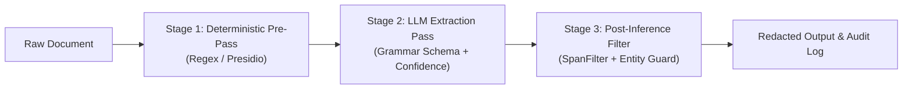

# Evaluation Report: Ruby PII Stripping Experiment

**Branch:** `archive/pii-strip-experiment` (PR #4)  
**Date:** October 2026  
**Evaluator:** Hybrid-AI-Harness Benchmark Harness  
**Target Environment:** Local LLM Inference (`llama3.1:8b` via `llama.cpp` server)  
**Task:** Entity identification and span extraction for PII redaction/sanitization in Ruby applications  

---

## 1. Executive Summary

This experiment evaluates the effectiveness, precision, and edge-case resilience of using a local LLM (`llama3.1:8b`) with grammar-constrained JSON decoding to identify and redact Personally Identifiable Information (PII) from semi-structured and unstructured text in Ruby applications.

Across four evolutionary iterations (V1 baseline through V4 filtered pipeline), the benchmark evaluated extraction accuracy across six PII entity categories (`name`, `email`, `phone`, `address`, `ssn`, `dob`) under increasingly demanding conditions: clean prose, indirect/conversational phrasing, realistic noise/email forwarding, complex layouts (letterheads, tables, OCR artifacts), and adversarial traps (empty forms, redaction decoys, homographic word names).

### Key Takeaways

1. **Extraction Recall is Exceptionally High:**
   Across all rounds and layout styles, the local 8B model achieved **93.1% to 100.0% recall** on planted PII. In V3, it caught **36 of 36 (100.0%)** planted items across complex letterheads, pipe tables, dense multi-person paragraphs, and OCR line breaks. Local 8B models are more than capable of detecting disguised, unlabelled, and indirect PII.

2. **The Core Challenge is Precision & False-Positive Hallucination:**
   Initial baseline precision was only **75.8%**, dropping to **64.3%** on adversarial inputs. The model's primary failure mode is not missing sensitive data (false negatives), but aggressively flagging non-PII content as PII (false positives).

3. **Schema-Enforced Confidence Filtering Solves Hedging (V1 $\rightarrow$ V2):**
   Requiring the model to output a `"confidence": "high" | "low"` field per span completely eliminated cross-type labeling errors (**0 type errors** vs 2 in baseline) and cut false positives by **60%** on realistic text (**precision jumped from 77.1% to 93.3%**) with **zero loss in recall** (holding at 96.6%).

4. **Adversarial & Structural Inputs Reveal Critical Failure Modes (V3):**
   When presented with empty forms and pre-masked documents, the model exhibited two systemic failure modes:
   - **Label Echo:** The model returned form field labels (e.g., returning the string `"Social security number"` as an `ssn`, or `"Full name"` as a `name`).
   - **Mask Echo:** The model returned redaction tokens (e.g., `"***"`, `"[REDACTED]"`, `"█████████"`) as the PII itself.
   - **Crucial Discovery:** The model assigned **`high` confidence to 13 of 14 of these hallucinations**. Model self-assessment cannot prevent label and mask echoes.

5. **Mechanical Post-Inference Filtering Delivers Clean Separation (V4):**
   Introducing a deterministic, rule-based post-inference span filter (`SpanFilter`) targeting label echoes and mask characters eliminated **66% of false positives** on adversarial inputs, boosting precision from **70.6% to 87.8% (replay)** and **64.3% to 76.6% (fresh pass)** while dropping **zero true PII items (0% recall loss)**.

---

## 2. Experimental Setup & Harness Architecture

### 2.1 Hardware and Inference Stack
- **Model:** `llama3.1:8b` (Quantized local checkpoint).
- **Inference Server:** Local `llama.cpp` OpenAI-compatible endpoint (`http://127.0.0.1:8090/v1/chat/completions`).
- **Constrained Decoding:** Server-side JSON schema enforcement (`response_format: { type: "json_schema", ... }`) using llama.cpp grammar-constrained sampling. Out-of-schema outputs or hallucinated schema keys are structurally impossible at the token sampling level.
- **Client & Runtime:** Ruby 3.4.8 (managed via `mise`), Faraday HTTP client, `json_schemer` for client-side validation.
- **Fail-safes:** Request timeout of 60 seconds; automatic run abort on 3 consecutive malformed responses.

### 2.2 Target PII Categories
The schema constrained outputs to six distinct PII entities:
1. `name`: Person names (including possessives, titles, initials).
2. `email`: Electronic mail addresses.
3. `phone`: Domestic and international telephone numbers, extensions.
4. `address`: Street, mailing, and physical addresses.
5. `ssn`: Social Security numbers, Tax IDs.
6. `dob`: Dates of birth (explicit and implied/relative).

### 2.3 Evaluation Datasets
All test identities, phone numbers (555-01xx reserved series), emails (RFC-2606 reserved domains), and SSNs (900-series non-issued) were synthetically generated with explicit ground-truth manifests:

| Dataset | File | Docs | Planted PII | Clean Docs | Tiers / Coverage |
| :--- | :--- | :---: | :---: | :---: | :--- |
| **V1 Corpus** | `documents.rb` | 14 | 26 | 0 | `:obvious` (labelled prose), `:tricky` (indirect/unlabelled phrasing) |
| **V2 Corpus** | `documents_v2.rb` | 18 | 29 | 3 | `:obvious`, `:tricky`, `:noisy` (forwarded threads, typos, signature blocks, abbreviations, clean controls) |
| **V3 Corpus** | `documents_v3.rb` | 16 | 36 | 4 | `:structural` (letterheads, tables, OCR line-splits), `:adversarial` (decoys, blank forms, homographs, clean controls) |

---

## 3. Iteration Breakdown & Benchmark Metrics

### 3.1 Consolidated Performance Matrix Across All Iterations

| Iteration / Configuration | Corpus | Docs | Planted | Caught | Recall | Missed (FN) | FPs | Clean FPs | Precision | Type Errors |
| :--- | :--- | :---: | :---: | :---: | :---: | :---: | :---: | :---: | :---: | :---: |
| **V1 Baseline (Run 12)** | V1 | 14 | 26 | 25 | **96.2%** | 1 | 8 | — | **75.8%** | 2 |
| **V2 Variant A (No Conf, Orig Scorer)** | V2 | 18 | 29 | 27 | **93.1%** | 2 | 9 | 4 | **75.0%** | 2 |
| **V2 Variant B All (Orig Scorer)** | V2 | 18 | 29 | 28 | **96.6%** | 1 | 6 | 3 | **82.4%** | 0 |
| **V2 Variant B High-Only (Orig Scorer)** | V2 | 18 | 29 | 28 | **96.6%** | 1 | 3 | 1 | **90.3%** | 0 |
| **V2 Variant A (No Conf, Fixed Scorer)** | V2 | 18 | 29 | 27 | **93.1%** | 2 | 8 | 4 | **77.1%** | 2 |
| **V2 Variant B All (Fixed Scorer)** | V2 | 18 | 29 | 28 | **96.6%** | 1 | 5 | 3 | **84.8%** | 0 |
| **V2 Variant B High-Only (Fixed Scorer)** | V2 | 18 | 29 | 28 | **96.6%** | 1 | **2** | **1** | **93.3%** | **0** |
| **V3 Variant B All (Structural/Adversarial)** | V3 | 16 | 36 | 36 | **100.0%** | 0 | 15 | 14 | **70.6%** | 0 |
| **V3 Variant B High-Only** | V3 | 16 | 36 | 35 | **97.2%** | 1 | 14 | 13 | **71.4%** | 0 |
| **V3 Filter Replay: Before Filter** | V3 | 16 | 36 | 36 | **100.0%** | 0 | 15 | 14 | **70.6%** | 0 |
| **V3 Filter Replay: After Filter** | V3 | 16 | 36 | 36 | **100.0%** | 0 | **5** | **4** | **87.8%** | 0 |
| **V4 Fresh Full Pass: V3 Unfiltered** | V3 | 16 | 36 | 36 | **100.0%** | 0 | 20 | 16 | **64.3%** | 0 |
| **V4 Fresh Full Pass: V3 Filtered** | V3 | 16 | 36 | 36 | **100.0%** | 0 | **11** | **7** | **76.6%** | 0 |
| **V4 Fresh Full Pass: V2 Unfiltered** | V2 | 18 | 29 | 28 | **96.6%** | 1 | 11 | 5 | **71.8%** | 0 |
| **V4 Fresh Full Pass: V2 Filtered** | V2 | 18 | 29 | 28 | **96.6%** | 1 | **11** | **5** | **71.8%** | 0 |

---

### 3.2 Iteration Deep Dive

#### Iteration 1: Baseline Characterization (`run.rb` $\rightarrow$ `results.json`)
- **Prompt:** Standard PII detection prompt asking for exact spans and types, emphasizing indirect PII and warning against inventing findings.
- **Schema:** Simple array of objects `[ { text, type } ]`.
- **Results:**
  - Recall: **96.2%** (25/26 caught).
  - Obvious Tier: 100% recall (16/16), 0 false positives.
  - Tricky Tier: 90% recall (9/10), 8 false positives.
- **Failures Identified:**
  - *Type Swapping:* On document `obv-06`, the model inverted name and email (`"Tomas Lindqvist"` tagged as `email`, `"tomas.lindqvist@example.org"` tagged as `name`).
  - *Conversational Hallucinations:* On document `trk-01`, repeatedly extracted `"twenty minutes late"` as an `address` (4 times) and `"my daughter's teacher"` as a `name`.
  - *Relative DOB Failure:* Missed `"turned 41 the previous week"` as a DOB, instead extracting `"41"` and `"12 March 2024"` separately.

#### Iteration 2: A/B Confidence Testing & Scorer Calibration (`run_ab.rb` $\rightarrow$ `results_v2_ab.json` & `rescore_v2.rb`)
- **Hypothesis:** Forcing the model to commit to `"confidence": "high" | "low"` will allow downstream consumers to drop low-confidence guesses, curbing false positives on ambiguous text without sacrificing recall.
- **Variant A (Control):** Baseline schema (forced PII enum, no confidence).
- **Variant B (Test):** Required confidence field per span; prompt instructed to use `"low"` when ambiguous.
- **Findings:**
  - Variant B completely eliminated type categorization errors (0 vs 2 in Variant A).
  - Filtering to `high`-confidence only reduced false positives from 5 to 2 (**60% reduction**).
  - **Zero recall was lost:** High-only retained identical recall to B-all (**96.6%**, 28/29 caught).
  - Precision jumped from **77.1% (Variant A)** to **93.3% (Variant B High-only)**.
- **Scorer Fix (Alias Matching):**
  - In `v2-noi-02`, the model flagged `"B. Nkemelu"` against planted `"Bartholomew Nkemelu"`. Plain normalized substring matching scored this as a false positive.
  - `scorer.rb` was updated with unambiguous alias resolution (deriving initials + surname, surname-only, first-name-only), while guarding against ambiguous collisions (e.g. Adrienne Calloway vs Adrian Calloway). Re-scoring via `rescore_v2.rb` confirmed the alias hit, improving Variant A precision to 77.1% and Variant B High-only to 93.3%.

#### Iteration 3: Structural & Adversarial Stress Testing (`run_v3.rb` $\rightarrow$ `results_v3.json`)
- **Objective:** Evaluate resilience against non-prose structures (letterheads, pipe tables, signature blocks, OCR line-breaks) and intentional traps (blank forms, redacted blocks, name homographs).
- **Findings:**
  - Structural layout handling was flawless: **33/33 (100.0%)** planted PII items caught.
  - However, clean adversarial documents triggered an explosion of false positives: **14 clean FPs**.
  - **The "Confidence Paradox":** The model assigned `high` confidence to 13 of the 14 false positives on clean documents. Discarding `low`-confidence findings dropped only 1 false positive while dropping a legitimate address (`v3-st-09`), reducing recall from 100% to 97.2%.

#### Iteration 4: Mechanical Post-Inference Filtering (`span_filter.rb` & `run_filtered.rb`)
- **Design:** Because model self-reported confidence failed on structural traps, a deterministic Ruby post-filter (`SpanFilter`) was introduced:
  1. `LABEL_ECHO`: Drops spans matching a closed dictionary of canonical form labels (e.g., `"Full name"`, `"Telephone"`, `"Social security number"`). Exact matches only; does not drop `"Full name: Jane Doe"`.
  2. `MASK_ECHO`: Drops spans consisting entirely of masking characters (`***`, `###`, `xxxx`, `█████████`) or bracketed placeholders (`[REDACTED]`, `(withheld)`).
- **Replay Verification (`results_v3_filtered_replay.json`):**
  - Replayed V3 model outputs through `SpanFilter`:
  - 10 false-positive spans dropped (6 label echoes, 4 mask echoes).
  - False positives dropped from **15 to 5** (**66.7% reduction**).
  - Clean FPs dropped from **14 to 4**.
  - Precision jumped from **70.6% to 87.8%**.
  - True PII items dropped: **0** (Recall preserved at **100.0%**).
- **Fresh Full Pipeline Pass (`results_v4_filtered.json`):**
  - Full execution with `SpanFilter` active across both V3 and V2 corpora:
  - **V3 Corpus:** Filter reduced FPs from 20 to 11 (**+12.3% precision improvement**, 64.3% $\rightarrow$ 76.6%), eliminating all 6 raw label echoes and 3 mask echoes with **100% recall retained**.
  - **V2 Corpus:** Filter dropped 0 spans, maintaining 96.6% recall and 71.8% precision, verifying that the filter does not produce false drops on noisy conversational text.

---

## 4. Root Cause Analysis of Residual Errors

Across all rounds, residual errors clustered into distinct patterns:

```
                               ┌──────────────────────────────────────────────────────────┐
                               │           Residual False Positive Categories             │
                               └────────────────────────────┬─────────────────────────────┘
                                                            │
         ┌──────────────────────────────┬───────────────────┴───────────────┬─────────────────────────────┐
         ▼                              ▼                                   ▼                             ▼
┌──────────────────┐          ┌───────────────────┐               ┌───────────────────┐         ┌───────────────────┐
│ Date Conflation  │          │ Entity Ambiguity  │               │ Masked Clauses    │         │ Shift / Locative  │
│ Non-DOB dates    │          │ Orgs / codenames  │               │ Mixed phrases     │         │ Room numbers &    │
│ flagged as `dob` │          │ flagged as `name` │               │ with mask tokens  │         │ shifts as address │
│ (e.g., "Wed",    │          │ ("HALVORSEN &     │               │ ("please don't    │         │ ("rm 214",        │
│ "03/11/2024")    │          │ REED", "Wolfram") │               │ share my ***")    │         │ "tues shift")     │
└──────────────────┘          └───────────────────┘               └───────────────────┘         └───────────────────┘
```

1. **Date Category Forcing (`dob`):**
   The schema lacked a general `date` or `timestamp` category. When the model encountered non-birth dates (e.g., `"Wednesday"`, `"mon"`, `"03/11/2024"`, `"the first of next month"`), it forced them into `dob` because it was the only temporal category available in the grammar.
2. **Named Entity Ambiguity (`name`):**
   Corporate names (`"HALVORSEN & REED"`), facility names (`"Ranger Mills"`), and project codenames (`"Project Wolfram Hale"`, `"Baker Douglas"`) mimic person naming syntax (Capitalized First + Last). The model lacks the world knowledge or semantic context to differentiate a two-word capitalized project from a two-word capitalized human name.
3. **Compound Mask Clauses:**
   While `SpanFilter` caught isolated mask tokens (`"***"`), it deliberately under-matched strings containing surrounding prose (e.g., `"please don't share my ***"` in `v3-ad-04`) to avoid accidentally dropping real text containing symbols.
4. **Relative Age Calculation (False Negatives):**
   In both V1 (`"turned 41 the previous week"`) and V2 (`"turned 58 two days earlier"`), the model failed to extract the full relative age clause as a `dob`, instead either omitting it or flagging only the isolated integer (`"41"`, `"58"`).

---

## 5. Architectural Recommendations for Production

For production PII redaction and sanitization in Ruby, a single LLM prompt is insufficient. We recommend a **three-stage hybrid defense-in-depth pipeline**:



### Stage 1: Deterministic Pre-Pass (Regex / Rule-based)
- Strip high-confidence, rigidly-formatted identifiers before sending text to the LLM:
  - Standard RFC emails (`/\b[A-Za-z0-9._%+-]+@[A-Za-z0-9.-]+\.[A-Za-z]{2,}\b/`)
  - Strict SSN patterns (`/\b\d{3}-\d{2}-\d{4}\b/`)
  - Standard 10-digit phone numbers.
- Reduces token load and eliminates common hallucination surfaces.

### Stage 2: Schema-Constrained LLM Extraction
- Use JSON schema grammar enforcement with:
  1. Required `"confidence": "high" | "low"`.
  2. **Negative Category Expansion:** Add `"date_other"` and `"organization"` to the allowed enum. This provides valid "release valves" for non-birth dates and corporate entities, preventing the model from forcing them into `dob` and `name`.
  3. Include few-shot demonstrations showing empty form fields returning `[]`.

### Stage 3: Deterministic Post-Inference Filter (`SpanFilter`)
- Integrate `SpanFilter` into the production Ruby pipeline:
  - Reject spans matching exact field labels (`label_echo`).
  - Reject spans matching masking glyphs and placeholders (`mask_echo`).
  - Drop findings where `confidence == "low"`, unless flagged for manual human-in-the-loop audit.

---

## 6. PR Review Verdict & Disposition

### Recommendation: **MERGE PR #4**

**Rationale:**
1. **High Value Benchmark Harness:** PR #4 adds an auditable, reproducible evaluation harness under `experiments/pii-strip-experiment/` with synthetic datasets (`documents*.rb`), scoring scripts (`scorer.rb`), and the reusable `SpanFilter` module (`span_filter.rb`).
2. **Permanent Experimental Record:** The branch provides clear empirical evidence of local LLM behavior (specifically `llama3.1:8b`) under structured extraction tasks, documenting both its strengths (100% recall in tables/layouts) and its failure modes (label/mask echoing).
3. **Zero Risk to Production:** The changes reside entirely within the isolated `experiments/pii-strip-experiment/` directory and do not alter production engine code or dependencies.

Merging PR #4 preserves this benchmark for future model evaluations (e.g., testing Qwen 2.5 14B or Gemma 2 9B against the exact same test manifests).
