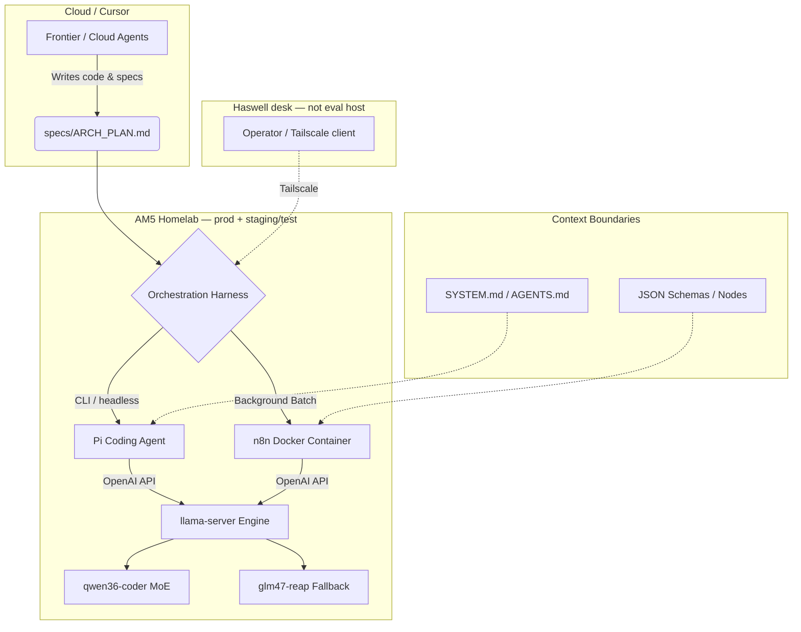

# AM5 Homelab AI Stack Architecture

## Overview

Local AI stack for the **AM5 homelab** (Ryzen 7 9700X, RTX 3060 12GB VRAM, 32GB DDR5, **Fedora Server**). That node is **production and staging/test** for inference, Alpha benchmarks, and Omega-supervised Pi. It is not the Haswell desk machine. Primary software development is via Cursor cloud agents. Full topology: [`infrastructure-topology.md`](infrastructure-topology.md).

Older text called this host “Workstation”; keep that alias in mind when reading historical reports.

The stack uses a **Frontier-to-Local Handoff Workflow**:
1. Frontier / cloud agents generate stage-gated architectural plans (`ARCH_PLAN.md`) and develop harness code.
2. The AM5 homelab executes offline against local models, keeping PII on-mesh.

---

## Component Architecture

---

## 1. The Execution Engine (`engine/`)
The bedrock of the stack is the `llama.cpp` server optimized for the RTX 3060 on Fedora Server.
* **API:** Exposes a standard OpenAI-compatible endpoint at `http://127.0.0.1:8080/v1`.
* **Hardware Profile:** Uses a `-cpu-moe` strategy. The massive 35B model parameters are pinned into system DDR5 RAM via `mlock` (requiring `ulimit -l` modifications), leaving the 12GB VRAM entirely free for ultra-fast attention caching and context limits.
* **Presets:** Managed via `engine/models.ini` (e.g., `[qwen36-coder]`, `[glm47-reap]`).

## 2. Context Guardrails (`specs/` & `prompts/`)
Local models easily degrade into infinite reasoning loops (e.g., generating 40,000 characters over 280 seconds without producing code). 
* **The Fix:** The `prompts/local_agent_system_prompt.md` acts as a hard boundary, forcing the MoE to restrict its scratchpad reasoning to 3-5 concise bullet points.
* **The Spec:** `specs/ARCH_PLAN_TEMPLATE.md` mandates that the frontier model breaks tasks down into isolated, single-step phases, allowing the local engine to operate with a fresh context per step (Amnesia by Design).

## 3. Background Automation Harness (`automation/n8n/`)
For background, cron-based tasks like PII stripping or email triage.
* **Deployment:** Containerized in Docker using `network_mode: host` to achieve zero-overhead connectivity to the local engine **on AM5**.
* **Workflows:** Utilizes zero-credential HTTP nodes or `n8n-nodes-base.openAi` nodes mapped strictly to `localhost:8080/v1`, enforcing strict JSON parsing (e.g., `email_triage_workflow.json`).

## 4. Local Coding Harness (`harness/pi/`)
The interactive / headless agent used to execute `ARCH_PLAN.md` or Omega sessions **on AM5**.
* **Framework:** Powered by the [Pi coding agent](https://pi.dev) via Node.js/npm.
* **Integration:** Connects natively to `llama-server` using `pi-llama-cpp`.
* **Context Engineering:** `SYSTEM.md` and `AGENTS.md` inject local guardrails and instruct Pi to read `ARCH_PLAN.md` before file edits.
* **Optimization:** Because Pi sends context deltas instead of full histories, prompt prefill speeds hit ~1,000 tokens/second by reusing the engine's chunk cache.
